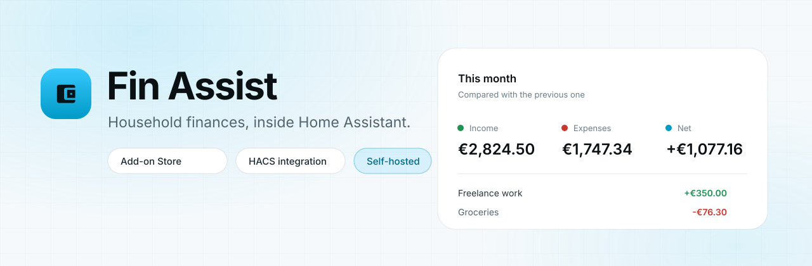
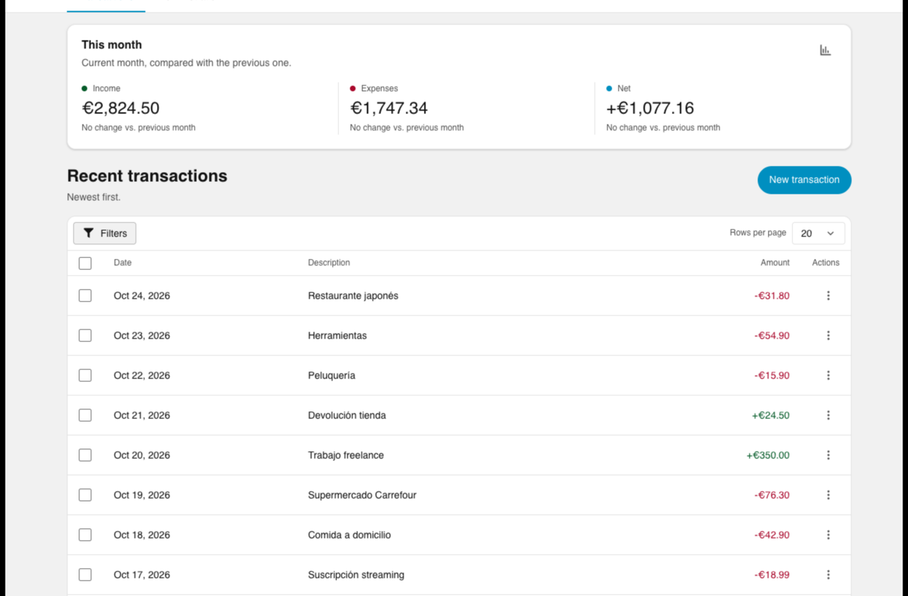
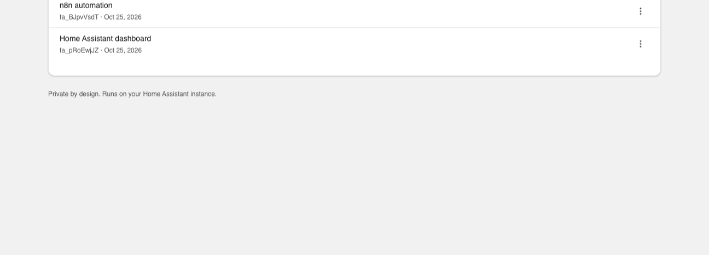

<p align="center">
  <picture>
    <source media="(prefers-color-scheme: dark)" srcset="docs/assets/banner-dark.svg">
    
  </picture>
</p>

<p align="center">
  <a href="https://github.com/MarioMH8/ha-finassists/actions/workflows/ci.yml"></a>
  
  
  
  <a href="LICENSE"></a>
</p>

<h3 align="center">The expense tracker that lives where your home already lives.</h3>

<p align="center">
  Log an expense from the dashboard, from an automation, or with the help of an AI assistant. Fin Assist keeps one private household ledger — no spreadsheets, no cloud, no subscription.
</p>

---

## Why Fin Assist

| | |
| :-- | :-- |
| 🧾 **Record in seconds**<br>An amount, a date, an optional note. That is the whole form. | 📊 **See the month**<br>Income, expenses and net, compared with last month, plus a six-month chart. |
| 🔎 **Find anything**<br>Search, filter by type and date range, edit a transaction, or delete in bulk. | 🤖 **Automate it**<br>Services and sensors let any automation record spending and read the totals. |
| 🧠 **Ask your AI**<br>A built-in MCP server lets assistants read and write transactions with a token you control. | 🔒 **Private by design**<br>One SQLite file in your instance, included in Home Assistant backups. Nothing leaves your home. |

## A look inside

<p align="center">
  <picture>
    <source media="(prefers-color-scheme: dark)" srcset="docs/assets/screenshots/transactions-en-dark.png">
    
  </picture>
</p>

<details>
<summary>More screenshots</summary>

<br>

<p align="center">
  <picture>
    <source media="(prefers-color-scheme: dark)" srcset="docs/assets/screenshots/administration-en-dark.png">
    
  </picture>
</p>

</details>

## Get started

<p align="center">
  <a href="https://my.home-assistant.io/redirect/supervisor_add_addon_repository/?repository_url=https%3A%2F%2Fgithub.com%2FMarioMH8%2Fha-finassists"></a>
  <a href="https://my.home-assistant.io/redirect/hacs_repository/?owner=MarioMH8&repository=ha-finassists&category=integration"></a>
</p>

Both buttons open **your own** Home Assistant, not this website: the first adds this repository to the add-on store, the second opens the integration in HACS.

### 1. Install the app

In Home Assistant, open **Settings → Add-ons → Add-on Store**, select **⋮ → Repositories**, add `https://github.com/MarioMH8/ha-finassists`, then install and start **Fin Assist**. Pick your currency during installation — every amount in the ledger uses it.

### 2. Add the integration

Open **HACS → Integrations → ⋮ → Custom repositories**, add the same URL as an **Integration**, install **Fin Assist** and restart Home Assistant. The integration discovers the running app and asks you to confirm — no tokens to copy, no URLs to type.

### 3. Pin the card to a dashboard

```yaml
type: custom:fin-assist-card
```

The card ships with the integration. In a storage-mode dashboard, add `/ha_finassists/fin-assist-card.js` as a **JavaScript module** resource under **Settings → Dashboards → Resources** first.

## What you get

- **A dashboard that opens in one click.** The app runs behind Home Assistant Ingress and follows your light or dark theme, in Spanish or English.
- **Sensors for your dashboard:** *Income this month* and *Expenses this month*.
- **Services for automations:** `ha_finassists.add_expense`, `add_income`, `delete_transaction` and `refresh`.
- **A REST API and an MCP server** (`/api/v1` and `/mcp`) for scripts, local tools and assistants. Each person manages their own revocable tokens from the **Administration** page.
- **Your data, in your backups.** Everything lives in `/data/fin-assist.sqlite` inside the add-on.

## Where it is going

Fin Assist starts with the essentials — recording expenses and incomes and seeing the month at a glance — because a ledger you can trust is the foundation for everything else. Household finance deserves more than one screen: categories, recurring payments, budgets and reports are on the roadmap, each landing as a deliberate, well-tested step.

## Contributing

Development, architecture and packaging notes live in [CONTRIBUTING.md](CONTRIBUTING.md). Bug reports and ideas are welcome in [the issue tracker](https://github.com/MarioMH8/ha-finassists/issues). Fin Assist is released under the [MIT license](LICENSE).

<p align="center"><sub>Built for Home Assistant. Runs entirely on your own hardware.</sub></p>
